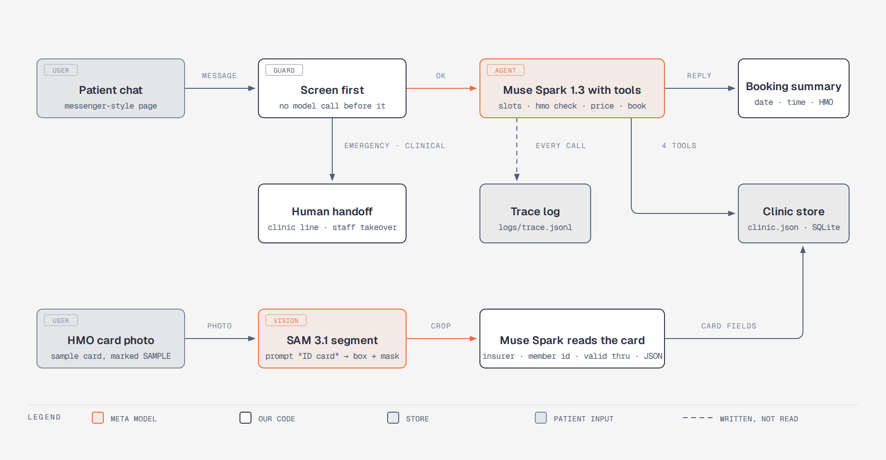

# Front Desk on Meta models

An after-hours front desk for Philippine dental clinics. A patient messages the clinic at night: the agent answers from the
clinic's own facts, reads a photo of their HMO card, checks it against the clinic's HMO list, offers only open slots from the
clinic's schedule and books the visit. A voice
note works the same way. Medical questions never reach the model: they go to the dentist. Staff can take over any chat.

Try it: **https://frontdesk.aaroncabantugan.com** (sample clinic, fake data). Ask "Do you accept Maxicare? I need a cleaning",
send a sample card from [data/cards/](data/cards/), tap the mic and ask by voice, or ask "what medicine can I take?" to see the
guard. The panel on the right shows every step the agent took, with real timings.

Demo video (2 minutes): the link is added with the submission.

Built for the Meta Global AI Developer Hackathon, Startup track ("Build for Your World"), Oct 26 to Nov 4, 2026 ET. Fake clinic,
fake patients, fake HMO cards marked SAMPLE; no HeyDenta code, keys, prompts or patient data.

Timeline, stated plainly: the window opened Oct 26 at 12:00 PM ET (16:00 UTC; the event page also says EST, which would be
17:00 UTC). The first five commits, Oct 26 03:23 to 03:27 UTC, came before it either way: a README stub and .gitignore, the planning docs (docs/SPEC.md, docs/CHECKS.md), two sample card images
(data/sample_cards, not used by the app) and a standalone API test script (scripts/day1_calls.py, not used by the app). All the
app code, the evals, the chat page, voice notes and the staff view were written after the start.

## Meta models used

| Model | What it does here |
|---|---|
| `muse-spark-1.3` | the chat agent: reads the clinic facts, calls the tools (open slots, HMO check, price list, booking), replies in the patient's language |
| `muse-spark-1.3` (vision) | reads the HMO card: insurer, member name, member ID, valid thru, and a confidence score |
| `sam-3.1` | finds the card in the photo and crops it before the read |
| `muse-voice-transcribe-1.0` | turns a patient's voice note into text, English and Tagalog |

## How it works



1. Safety screen first: emergency words, medical questions, rule-change attempts and staff takeover get a fixed reply; the model is not called.
2. Everything else goes to Muse Spark with four tools. Prices, slots, coverage and the booking summary come from the tools and are quoted word for word.
3. A card photo: SAM 3.1 crops, Muse Spark reads, the HMO check runs against the clinic's accepted list; an unclear card gets "send a clearer photo".
4. A voice note: Muse Voice transcribes, then step 1 and 2 run on the text.
5. Staff view (read only, behind a key): today's counts, upcoming bookings with masked mobiles, the chats staff took over.

## Eval

Last run 2026-10-28: 20 of 20 chats pass the rule check, 20 of 20 pass the judge (deepseek/deepseek-v4-flash) (live mode)

Voice notes 2026-10-28: 5 of 5 pass (transcribed by muse-voice-transcribe-1.0, then the same rule checks; live mode)

20 typed chats (15 English, 5 Taglish) in [evals/chats.json](evals/chats.json), each scored by rules and by a judge from another
provider; 5 voice notes in [evals/voice_notes.json](evals/voice_notes.json), synthetic voices, scored on what was said. Full
results with every reply: [evals/results-2026-10-28.json](evals/results-2026-10-28.json) and
[evals/voice-results-2026-10-28.json](evals/voice-results-2026-10-28.json).

Limits: 20 chats and 5 synthetic voice notes are a smoke test, not a measure of accuracy with real patients; the judge is one
model. The clinic is fake, coverage answers come only from the clinic's own HMO list, and the clinic confirms every booking.

## Run it

```
make test   # pytest in stub mode, no key, no network
make dev    # http://localhost:8000
make eval   # the 20 chats; make eval ARGS=--judge adds the judge (needs OPENROUTER_API_KEY)
python3 evals/run_voice_evals.py   # the 5 voice notes (FRONTDESK_LIVE=1 and MODEL_API_KEY for the live models)
```

With no `MODEL_API_KEY` (or with `FRONTDESK_STUB=1`) a deterministic stub stands in for the model, so the app and the tests run
with no network. Every model call writes one line to `logs/trace.jsonl`; bookings and chat turns live in `data/frontdesk.db`.
The staff view needs `FRONTDESK_STAFF_KEY` set and opens at `/staff?key=...`.

## About the data
The clinic, the patients, the schedule and the member IDs are invented. The HMO names in the accepted list are real Philippine HMOs, used only as names; the covered services and notes are this sample clinic's demo arrangement, not any insurer's published plan. Every card image is drawn by us in one neutral color, carries no logo, and says it was not issued by the insurer.
